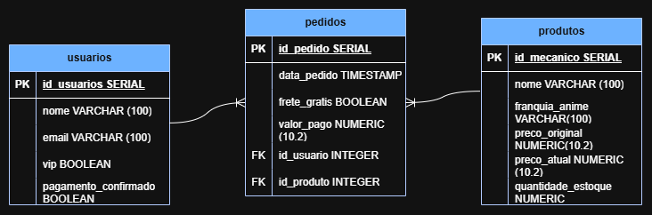

 # Geek Store
Esse site foi solicitado por Pedro Júnior Henrique dos Santos, com o objetivo de criar um estoque para a loja de action figures. O sistema deve permitir cadastro de produtos coletando os nomes, franquia, preço e quantidade. E por fim, o sistema deve reajustar automaticamente o preço do produto, aplicando um aumento de 10% sobre o valor original, quando a quantidade em estoque for reduzida a exatamente 1 unidade.

## Mer
### Usuarios
- id_usuario SERIAL PK
- nome VARCHAR(100)
- email VARCHAR(100)
- vip BOOLEAN
- pagamento_confirmado BOOLEAN

### Produtos
- id_produto SERIAL PK
- nome VARCHAR(100)
- franquia_anime VARCHAR(100)
- preco_original NUMERIC(10,2)
- preco_atual NUMERIC(10,2)
- quantidade_estoque NUMERIC

### Pedidos
- id_pedido SERIAL PK
- id_usuario SERIAL FK
- id_produto SERIAL FK
- data_pedido TIMESTAMP
- frete_gratis BOOLEAN
- valor_pago NUMERIC(10,2)

### relacionamento
- 1 cliente para N pedidos
- 1 produto para N pedidos
## Der

